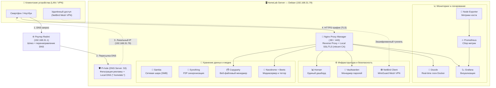

# 🏠 HomeLab Infrastructure

Персональная серверная инфраструктура (**HomeLab**) на базе **Debian Linux**, построенная по принципу *Infrastructure as Code* с использованием **Docker Compose**. Проект создан для отработки навыков системного администрирования, построения отказоустойчивых сетей, мониторинга и обеспечения информационной безопасности.

---

## 🗺️ Архитектура сети и маршрутизация трафика



---

## 🛠️ Стек технологий

* **ОС и виртуализация:** Debian Linux (Trixie), Docker, Docker Compose
* **Сети и проксирование:** Nginx Proxy Manager, Pi-hole (DNS), NetBird (Mesh VPN)
* **Безопасность и PKI:** Локальный центр сертификации (`mkcert` / OpenSSL SAN), Vaultwarden (Bitwarden-совместимый сервер), изоляция Docker-сетей
* **Мониторинг и Observability:** Prometheus, Node Exporter, Grafana, Dozzle
* **Хранилище и синхронизация:** Samba (SMB), Syncthing, Copyparty
* **Медиа-сервисы:** Navidrome, Beets

---

## 📦 Состав сервисов

| Категория | Сервис | Назначение | Локальный домен |
| :--- | :--- | :--- | :--- |
| **Сеть и доступ** | **Pi-hole** | Локальный DNS-сервер и блокировка рекламы/трекеров на уровне всей сети | `homelab.pihole` |
| **Сеть и доступ** | **Nginx Proxy Manager** | Обратный прокси (Reverse Proxy) и терминация SSL/TLS | `homelab.npm` |
| **Сеть и доступ** | **NetBird** | Защищённый Mesh-VPN (на базе WireGuard) для доступа к лабе извне | — |
| **Безопасность** | **Vaultwarden** | Self-hosted сервер для хранения паролей и 2FA-токенов | `homelab.vault` |
| **Управление** | **Homarr** | Стартовый дашборд с быстрым доступом ко всем сервисам и виджетами | `homelab.local` |
| **Мониторинг** | **Prometheus** | Сбор и хранение time-series метрик с хоста и сервисов | `homelab.prometheus` |
| **Мониторинг** | **Node Exporter** | Экспорт аппаратных метрик Debian-сервера (CPU, RAM, Disk, Network) | `homelab.exporter` |
| **Мониторинг** | **Grafana** | Дашборды визуализации состояния сервера и алертинг | `homelab.grafana` |
| **Логирование** | **Dozzle** | Веб-интерфейс для просмотра логов всех Docker-контейнеров в реальном времени | `homelab.dozzle` |
| **Файлы** | **Samba** | Локальное сетевое хранилище для обмена файлами между устройствами | `\\192.168.31.79` |
| **Файлы** | **Syncthing** | Непрерывная P2P-синхронизация директорий между ПК и сервером | `homelab.sunc` |
| **Файлы** | **Copyparty** | Лёгкий веб-сервер для загрузки и раздачи файлов по HTTP/HTTPS | `homelab.upload` |
| **Медиа** | **Navidrome / Beets** | Стриминговый аудиосервер и автоматический каталогизатор музыки | `homelab.navidrome` |

---

## 🔒 Безопасность и управление конфигурациями

* **Шифрование внутреннего трафика:** Все веб-интерфейсы доступны по `HTTPS`. Выпущен собственный корневой центр сертификации (`mkcert CA`), добавленный в доверенные хранилища клиентских устройств.
* **Защита чувствительных данных:** Все пароли, токены и секреты вынесены в `.env`-файлы и исключены из индексации Git.
* **Изоляция данных:** Персистентные данные контейнеров (`vw-data/`, `data/`, базы SQLite, SSL-ключи) строго изолированы через `.gitignore` — в репозитории хранится только декларативное описание инфраструктуры.

---

## 🚀 Быстрый старт (развёртывание сервиса)

Каждый сервис вынесен в отдельную директорию со своим `compose.yaml` и шаблоном переменных окружения:

```bash
# 1. Клонирование репозитория
git clone https://github.com
cd HomeLabProject/<имя_сервиса>

# 2. Настройка переменных окружения (при наличии .env.example)
cp .env.example .env
nano .env

# 3. Запуск контейнера в фоновом режиме
docker compose up -d
```
